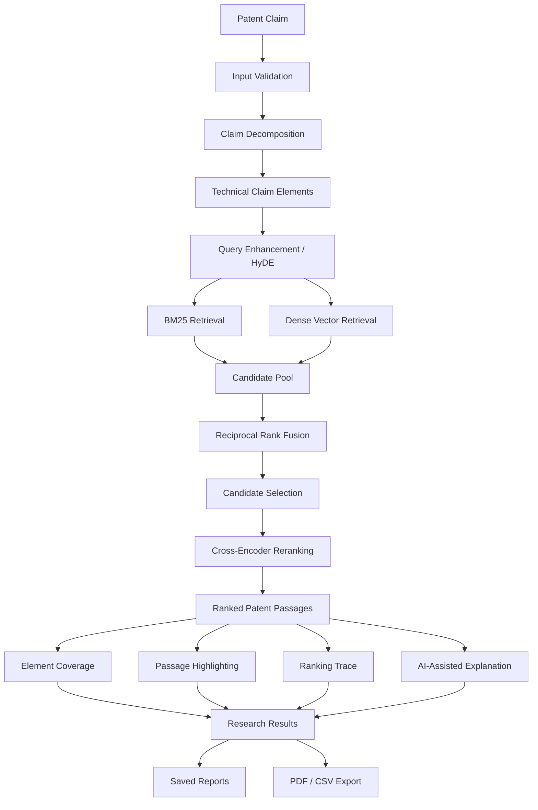
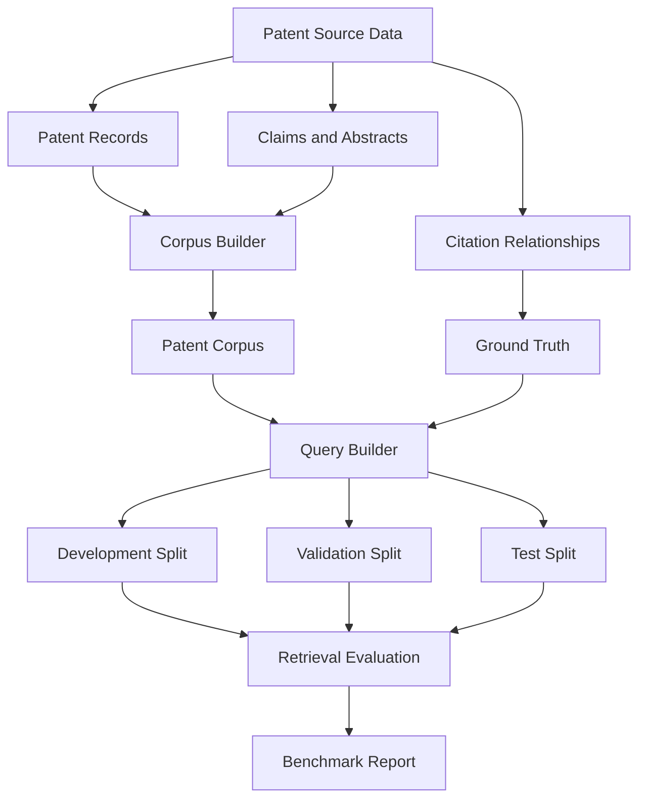

# 🔬 Priorly — AI-Powered Patent Prior-Art Search Engine

<p align="center">
  <strong>Search Beyond Keywords. Discover Relevant Prior Art.</strong>
</p>

<p align="center">
  An explainable, hybrid patent retrieval system that transforms patent claims into technical elements, searches by keywords and semantic meaning, combines candidate rankings, and presents relevant patent passages with claim-element coverage and ranking insights.
</p>

<p align="center">
  <a href="PENDING_DEPLOYMENT_LINK">
    
  </a>
  <a href="https://github.com/AfzalManihar/Priorly-AI-Patent-Search">
    
  </a>
</p>

<p align="center">
  
  
  
  
  
  
  
</p>

---

## 📌 Overview

Patent prior-art research is challenging because technically similar inventions can be described using completely different terminology.

Traditional keyword search may miss relevant documents when the wording differs. Semantic search can identify conceptual similarities, but may overlook exact technical terms and identifiers.

**Priorly** addresses this retrieval challenge through a multi-stage patent search pipeline.

Paste a patent claim and Priorly processes it through:

- Technical claim decomposition.
- Keyword-based BM25 retrieval.
- Semantic dense-vector retrieval.
- Reciprocal Rank Fusion (RRF).
- Cross-encoder reranking.
- Claim-element coverage analysis.
- Passage highlighting and ranking explanations.

The goal is not simply to return similar documents, but to make the retrieval process more transparent and measurable.

> Priorly is a research-assistance tool. Its results are not legal determinations of patent validity, patentability, infringement, or freedom to operate.

## 🎯 Project Goals

- Improve patent discovery beyond exact keyword matching.
- Combine lexical and semantic retrieval.
- Make retrieval decisions easier to inspect and understand.
- Evaluate retrieval using available examiner-citation relationships.
- Provide a practical interface for patent research workflows.
- Build a modular system that can be measured and improved stage by stage.

## ✨ Key Features

| Feature | Description |
|---|---|
| 🔍 Claim-Based Search | Search using natural-language patent claims. |
| 🧩 Claim Decomposition | Break complex claims into smaller technical elements. |
| 🔤 BM25 Retrieval | Retrieve documents using technical keyword relevance. |
| 🧠 Dense Retrieval | Discover conceptually similar patent passages using embeddings. |
| 🔀 Hybrid Retrieval | Combine lexical and semantic rankings using RRF. |
| 🎯 Cross-Encoder Reranking | Reassess and reorder candidate passages. |
| 💡 HyDE Query Enhancement | Support hypothetical-document-based semantic retrieval. |
| 📍 Passage Highlighting | Highlight matching technical content. |
| 🧩 Element Coverage | Show which claim elements are represented in retrieved passages. |
| 🔎 Ranking Trace | Expose available retrieval and ranking signals. |
| 🤖 AI Explanations | Generate contextual explanations using the configured LLM. |
| 💾 Search History | Store and retrieve previous search records. |
| 📄 PDF Reports | Generate downloadable patent-search reports. |
| 📊 Benchmark Dashboard | Inspect configured retrieval evaluation results. |
| 📥 CSV Export | Export supported report and benchmark data. |
| ⚙️ Configurable Backends | Switch between offline and model-backed components. |
| 🛡️ Application Safeguards | Apply request validation, rate limits, and security controls. |

Feature availability depends on the active configuration, corpus, and connected services.

## 🖥️ Live Application

**Deployment status: Pending**

**Live Demo:** `PENDING_DEPLOYMENT_LINK`

The public deployment URL will be added after deployment and end-to-end verification.

Until then, Priorly can be run locally using the installation instructions below.

## 🏗️ System Architecture

Priorly follows a modular retrieval architecture. Each stage has a separate responsibility, making the pipeline easier to evaluate, debug, and improve.

### End-to-End Workflow



### How the Pipeline Works

**1. Claim Decomposition**

The submitted claim is analyzed and separated into smaller technical elements. This helps the system search for individual concepts rather than relying only on the original sentence.

**2. Query Enhancement — HyDE**

Hypothetical Document Embeddings can generate an expanded technical description to support semantic retrieval.

**3. Lexical Retrieval — BM25**

BM25 identifies passages containing relevant technical terminology and helps preserve exact keyword matches.

**4. Dense Retrieval — BGE**

The BGE embedding model converts patent passages into vector representations. Qdrant supports similarity-based candidate retrieval.

**5. Reciprocal Rank Fusion — RRF**

RRF combines lexical and semantic rankings into a unified candidate list.

**6. Cross-Encoder Reranking**

A BGE cross-encoder evaluates candidate relevance more directly and reorders the retrieved passages.

**7. Result Analysis**

The application presents available patent information, matching passages, claim-element coverage, ranking signals, and configured AI explanations.

## 🧠 Technology Stack

| Technology | Purpose |
|---|---|
| Python | Core application and retrieval logic |
| FastAPI | Backend API framework |
| HTML, CSS, JavaScript | Frontend application |
| Sentence Transformers | Embedding and reranking integration |
| BGE | Dense embeddings and cross-encoder reranking |
| Qdrant | Vector database |
| BM25 | Lexical information retrieval |
| TF-IDF | Lightweight offline retrieval backend |
| Reciprocal Rank Fusion | Hybrid ranking |
| Groq | LLM inference |
| SQLite | Application persistence and caching |
| Pydantic | Configuration and data validation |
| Pytest | Automated testing |
| Docker | Containerized application support |
| GitHub Actions | Continuous integration |

### Model Configuration

| Component | Model / Backend |
|---|---|
| Dense Embeddings | `BAAI/bge-base-en-v1.5` |
| Cross-Encoder Reranker | `BAAI/bge-reranker-base` |
| LLM Provider | Groq |
| Preferred LLM Model | `openai/gpt-oss-20b` |
| Vector Store | Qdrant |

The actual model selection is controlled by environment configuration.

## 🔌 Offline and Real Backends

Priorly supports lightweight offline backends as well as model-backed retrieval.

| Configuration | Offline Backend | Real Backend |
|---|---|---|
| `DENSE_BACKEND` | `tfidf` | `bge` |
| `RERANK_BACKEND` | `lexical` | `bge` |
| `LLM_BACKEND` | `heuristic` | `groq` |

### Offline Mode

Offline mode uses:

- TF-IDF instead of BGE semantic embeddings.
- Lexical scoring instead of cross-encoder reranking.
- Rule-based decomposition and templated explanations instead of live LLM inference.

This mode is useful for development and automated testing. It should not be interpreted as full semantic retrieval or real LLM inference.

### Real Model Mode

The model-backed configuration enables:

- BGE dense embeddings.
- Qdrant vector retrieval.
- BGE cross-encoder reranking.
- Groq-based claim decomposition, query enhancement, and explanations.

Real model execution requires the appropriate dependencies, model availability, hardware resources, and provider configuration.

## 📚 Patent Data and Benchmarking

Priorly is designed to evaluate patent retrieval against available prior-art relationships, including examiner-cited patent references.

### Why Examiner Citations?

Examiner citations provide useful relevance signals for patent retrieval research.

They help construct evaluation queries and ground-truth relationships from patent examination records rather than relying entirely on manually invented examples.

However, examiner citations are incomplete. A document that was not cited is not necessarily irrelevant.

**Benchmark scores therefore represent retrieval performance against the available citation ground truth, not absolute patent-relevance accuracy.**

### Data Preparation Workflow



### Evaluation Leakage Controls

The evaluation workflow is designed to apply these safeguards:

- A query patent must not appear in its own retrieved results.
- Retrieved patents must satisfy the configured earlier-year restriction.
- Development data is used for tuning.
- Validation data is used for model and configuration selection.
- Test data is reserved for final reporting.

These controls help reduce evaluation leakage and make retrieval measurements more meaningful.

## 📊 Evaluation Metrics

The evaluation framework supports information retrieval metrics including:

| Metric | Purpose |
|---|---|
| Precision@K | Measures relevant documents among the top K results. |
| Recall@K | Measures how many known relevant documents are retrieved. |
| MRR | Measures the position of the first relevant result. |
| nDCG@K | Measures ranking quality with position-sensitive relevance. |
| Bootstrap Confidence Intervals | Estimates uncertainty around measured metrics. |

### Stage-Level Evaluation

The modular pipeline supports comparisons across retrieval stages:

- Dense retrieval.
- Hybrid retrieval.
- Reranking.
- Configurable stage skipping.
- Development, validation, and test splits.

Actual metric values should be generated using the configured real corpus and benchmark. Sample-corpus metrics must not be presented as real-world patent retrieval performance.

## Measured Retrieval Results

Results below use the real patent corpus and examiner-citation ground truth. These are subset measurements, not results across the complete dataset.

### Development split (20 queries ? Decompose + HyDE run)

| Run | Dense Recall@10 (95% CI) | Hybrid Recall@10 (95% CI) | Hybrid + rerank Recall@10 (95% CI) | + Decompose/HyDE Recall@10 (95% CI) | Precision@10 (Dense / Hybrid / Hybrid+rerank / Decompose+HyDE) | MRR (Dense / Hybrid / Hybrid+rerank / Decompose+HyDE) |
|---|---:|---:|---:|---:|---:|---:|
| DEV, 20 queries; Groq `openai/gpt-oss-120b`; `llm_layers_skipped=False`; degraded count 0 | 0.12 [0.01, 0.28] | 0.11 [0.0, 0.27] | 0.11 [0.0, 0.27] | 0.10 [0.0, 0.25] | 0.02 / 0.01 / 0.01 / 0.01 | 0.09 / 0.07 / 0.03 / 0.04 |

All four confidence intervals overlap; there is no measurable improvement at n=20. This 20-query DEV run is not comparable with the 60-query DEV table below (different n).

### Development split (60 queries)

| Retrieval stage | Recall@10 | 95% CI | Precision@10 | MRR |
|---|---:|---:|---:|---:|
| Dense only | 0.1453 | 0.0763–0.2283 | 0.0400 | 0.1455 |
| Hybrid (BM25 + RRF) | 0.1352 | 0.0712–0.2086 | 0.0467 | 0.1638 |
| Hybrid + cross-encoder rerank | 0.1118 | 0.0522–0.1860 | 0.0350 | 0.1056 |

### Test split (40 queries; run once)

| Retrieval stage | Recall@10 | 95% CI | Precision@10* | MRR* |
|---|---:|---:|---:|---:|
| Dense only | 0.1001 | 0.0323–0.1795 | 0.03 | 0.17 |
| Hybrid (BM25 + RRF) | 0.1113 | 0.0426–0.1924 | 0.04 | 0.15 |
| Hybrid + cross-encoder rerank | 0.0976 | 0.0300–0.1767 | 0.03 | 0.10 |

*Test precision and MRR are shown at the two-decimal precision printed by the evaluation output.

### Interpretation and limitations

- Corpus: 5,803 patents (5,799 with claims), 123,901 chunks, no description paragraphs; years 1976-2017.
- Query collection: 941 queries (376 DEV, 185 VAL, 380 TEST). Reported DEV and TEST results use subsets of 60 and 40 queries respectively.
- Reranker: top 20 candidates and 3 passages per patent.
- Examiner citations are incomplete relevance labels; scores are lower bounds, not absolute patent-relevance accuracy.
- All reported 95% Recall@10 confidence intervals overlap. No measurable difference or improvement between stages is established.
- The 60-query DEV and 40-query TEST tables report configurations without claim decomposition or HyDE; the separate 20-query DEV run is reported above.
- These results do not support a claim that reranking improves retrieval.
- The TEST split was run once and is frozen; do not regenerate or tune against it.

## 📄 Reports and Data Management

| Capability | Description |
|---|---|
| Search History | Store and retrieve previous search records. |
| Saved Reports | Save selected patent-search results. |
| PDF Export | Generate downloadable PDF reports. |
| CSV Export | Export supported report and benchmark information. |
| SQLite Storage | Persist application records and LLM cache. |
| Search Deletion | Delete an individual stored search where supported. |
| Data Erasure | Clear configured stored application data through the deletion workflow. |

Claims and search records should be handled according to the application's configured privacy and retention behaviour.

## ⚙️ Installation and Setup

### Requirements

- Python 3.10 or newer.
- Git.
- Windows, macOS, or Linux.
- Sufficient RAM and disk space for selected models and patent data.
- Docker only for the containerized workflow.
- Groq API key only when using the Groq backend.

### 1. Clone the Repository

```bash
git clone https://github.com/AfzalManihar/Priorly-AI-Patent-Search.git
cd Priorly-AI-Patent-Search
```

### 2. Create the Environment

**Recommended:**

```bash
make setup
```

**Windows PowerShell alternative:**

```powershell
python -m venv .venv
.\.venv\Scripts\Activate.ps1
python -m pip install --upgrade pip
pip install -r backend/requirements-dev.txt
```

### 3. Start Priorly

```bash
make serve
```

Open the application:

```text
http://localhost:8000
```

Available pages:

| Page | URL |
|---|---|
| Landing Page | `http://localhost:8000/` |
| Search Workspace | `http://localhost:8000/app.html` |
| API Documentation | `http://localhost:8000/docs` |

### 4. Run Automated Tests

```bash
make test
```

### 5. Run the Benchmark

```bash
make eval
```

The benchmark uses the corpus and benchmark paths configured for the application.

### 6. Run with Docker

```bash
docker compose up --build
```

The Docker workflow is intended to run the application with its configured Qdrant service.

## ⚙️ Configuring Real Models

Install the ML dependencies:

```bash
make setup-ml
```

Create a local environment file:

```powershell
Copy-Item .env.example .env
```

Configure the required values in `.env`:

```dotenv
DENSE_BACKEND=bge
RERANK_BACKEND=bge
LLM_BACKEND=groq

GROQ_API_KEY=
GROQ_MODEL=openai/gpt-oss-20b

EMBED_MODEL=BAAI/bge-base-en-v1.5
RERANK_MODEL=BAAI/bge-reranker-base

QDRANT_URL=:memory:
```

For a persistent local Qdrant server, configure its reachable URL instead:

```dotenv
QDRANT_URL=http://localhost:6333
```

Start Qdrant separately if using the server URL:

```bash
docker run -p 6333:6333 qdrant/qdrant
```

**Important:** Real model configuration can require model downloads, RAM, disk space, internet connectivity, and provider quota. Offline tests do not validate live integrations.

Never commit `.env` or actual API credentials.

## 🧪 Testing and Verification

Priorly includes automated tests covering:

- Retrieval pipeline components.
- Claim decomposition and pipeline stages.
- API endpoints and error handling.
- Search validation and rate limiting.
- Server-sent event streaming.
- Report generation and export.
- Application settings.
- Qdrant retrieval code paths.
- Ingestion and query-building workflows.
- Evaluation metrics and leakage controls.
- Production-oriented application behaviour.

Run the test suite:

```bash
make test
```

Run additional checks:

```bash
make check
```

### Testing Integrity

| Test Type | What It Validates |
|---|---|
| Unit Tests | Individual application components. |
| Mocked Integration Tests | Application logic against simulated dependencies. |
| Offline Pipeline Tests | Retrieval stages using offline backends. |
| Real Model Tests | Actual inference using selected models. |
| Live API Tests | External provider connectivity and responses. |
| Real Corpus Evaluation | Retrieval against configured real benchmark data. |
| Browser Testing | Actual interface behaviour in a browser. |

Passing mocked or offline tests does not prove that live model inference, external APIs, or production deployment are working.

## 🔐 Security, Privacy and Reliability

Priorly includes application-level safeguards such as:

- Request validation.
- Configurable rate limiting.
- Security response headers.
- API error handling.
- Configurable provider credentials.
- Protection against returning provider API keys through application endpoints.
- Search history and data deletion controls.
- SQLite-backed application storage.
- Request tracing and application metrics.

Production deployment should use HTTPS, secure environment configuration, database protection, and operational monitoring.

Never commit:

- `.env` files.
- API keys or credentials.
- Private datasets and raw patent data.
- Local databases and vector-store files.
- Virtual environments and generated caches.

## 📈 Observability

| Endpoint / Feature | Purpose |
|---|---|
| `GET /api/health` | Application health information. |
| `GET /api/metrics` | Configured application metrics. |
| Request Logs | Request identifiers, status, and timing. |
| Search Logs | Search-stage timings and degraded-stage information. |
| LLM Cache | Cache-related usage information. |

Performance targets must be measured on the intended deployment and corpus before being reported as achieved.

## 🔗 API Reference

The documented API surface includes:

| Method | Endpoint | Purpose |
|---|---|---|
| `POST` | `/api/search` | Execute patent search. |
| `POST` | `/api/search/stream` | Stream search progress and results. |
| `GET` | `/api/search/{id}` | Retrieve a stored search. |
| `DELETE` | `/api/search/{id}` | Delete a stored search. |
| `DELETE` | `/api/data?confirm=yes` | Delete configured stored data. |
| `GET` | `/api/benchmark` | Retrieve benchmark information. |
| `GET` | `/api/reports` | List saved reports. |
| `POST` | `/api/reports` | Save a report. |
| `GET` | `/api/reports/{id}/export.csv` | Export a report as CSV. |
| `GET` | `/api/reports/{id}/export.pdf` | Export a report as PDF. |
| `GET` | `/api/settings` | Retrieve application settings. |
| `PUT` | `/api/settings` | Update supported settings. |
| `GET` | `/api/health` | Health information. |
| `GET` | `/api/metrics` | Application metrics. |

The interactive API documentation at `/docs` is the authoritative reference for the running application's routes and schemas.

## 📁 Project Structure

```text
priorly/
│
├── frontend/
│   ├── index.html
│   ├── app.html
│   ├── css/
│   └── js/
│       ├── api.js
│       ├── app.js
│       └── data.js
│
├── backend/
│   ├── app/
│   │   ├── main.py
│   │   ├── pipeline.py
│   │   ├── retrievers.py
│   │   ├── fusion.py
│   │   ├── rerank.py
│   │   ├── llm.py
│   │   ├── highlight.py
│   │   ├── report_pdf.py
│   │   ├── corpus.py
│   │   ├── config.py
│   │   ├── store.py
│   │   └── live_patent_search.py
│   │
│   ├── ingest/
│   ├── eval/
│   ├── tests/
│   └── requirements-dev.txt
│
├── docs/
│   └── PRD.md
│
├── .github/
│   └── workflows/
│
├── .env.example
├── Makefile
├── docker-compose.yml
├── Dockerfile
└── README.md
```

This is a representative layout. The actual repository tree is authoritative.

## 📋 Product Requirements Document

Priorly's product requirements are documented in:

`docs/PRD.md`

The PRD defines the intended system behaviour, functional requirements, non-functional requirements, and implementation mapping.

Important sections:

- **Section 17:** Requirement-to-code-and-test traceability.
- **Section 20:** Implemented and outstanding requirements.

The published PRD includes diagrams and charts. The repository contains the text-only PRD reference.

Implementation status should be checked against the current code and tests, rather than inferred solely from the specification.

## 🚧 Development and Verification Status

| Area | Status |
|---|---|
| FastAPI application | Implemented |
| Patent claim search pipeline | Implemented |
| Claim decomposition | Implemented |
| BM25 retrieval | Implemented |
| Dense retrieval integration | Implemented |
| Reciprocal Rank Fusion | Implemented |
| Cross-encoder reranking | Implemented |
| AI-assisted explanations | Implemented |
| Passage highlighting | Implemented |
| Benchmark evaluation framework | Implemented |
| Search history and saved reports | Implemented; final verification required |
| PDF and CSV export | Implemented; final verification required |
| Production deployment | Pending |
| External live patent search | Not yet verified |

This status is not a claim of complete production readiness. Outstanding integrations and deployment workflows require separate verification.

## 🗺️ Roadmap

- Complete final report and export verification.
- Verify clean installation and end-to-end workflows.
- Complete real-corpus retrieval evaluation and record measured metrics.
- Improve indexing and retrieval performance for larger corpora.
- Expand verified patent-data coverage.
- Integrate a reliable, free public live-patent search source where access permits.
- Complete production deployment.
- Add the verified public deployment URL and screenshots.
- Update documentation with final measured performance.

## ⚠️ Limitations and Responsible Use

- Search results are limited to the configured patent corpus.
- A local corpus is not a complete or continuously updated patent database.
- Examiner citations provide incomplete relevance ground truth.
- Similarity scores are not probabilities of patentability.
- A technically similar document is not automatically legally relevant prior art.
- AI-generated explanations can contain errors.
- External live patent-source access is not currently verified.
- Model performance depends on configuration, hardware, and provider availability.
- Production latency, accessibility, and reliability targets must be measured before being claimed.

Priorly supports research and discovery. It does not replace a registered patent professional or a legal assessment.

## 👨‍💻 Author

**Afzal Manihar**

Interested in Data Science, Machine Learning, Generative AI, Agentic AI, and building practical AI-powered systems.

- 🌐 **Portfolio:** https://afzalmanihar.github.io
- 💻 **GitHub:** https://github.com/AfzalManihar
- 🔗 **LinkedIn:** https://www.linkedin.com/in/afzal-manihar-bb0183308/
- 📦 **Repository:** https://github.com/AfzalManihar/Priorly-AI-Patent-Search

## 📄 License

See the `LICENSE` file in the repository for the applicable license.

---

<p align="center">
  <strong>Priorly — Making Patent Prior-Art Discovery More Intelligent, Explainable, and Measurable.</strong>
</p>

<p align="center">
  ⭐ If you find this project interesting, consider starring the repository!
</p>